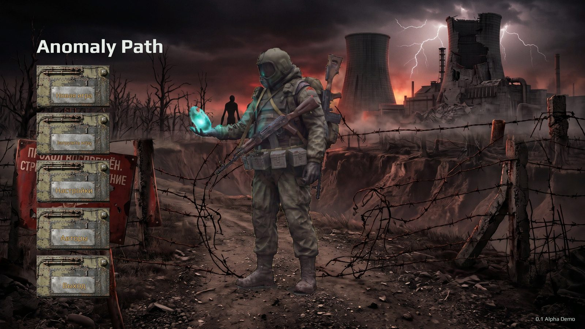
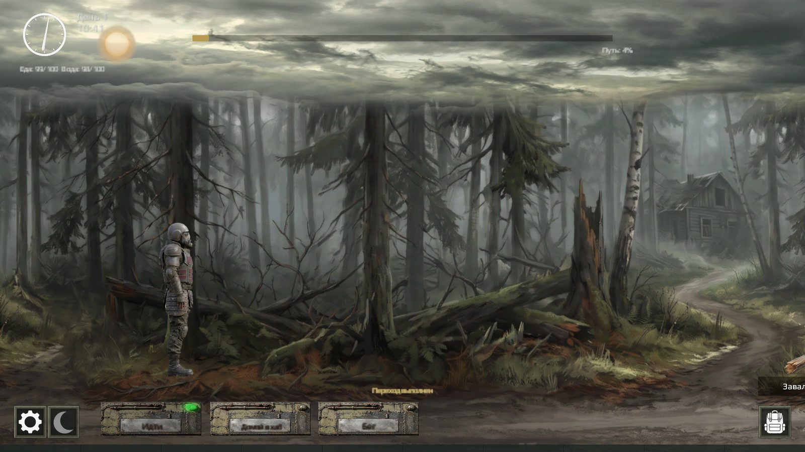
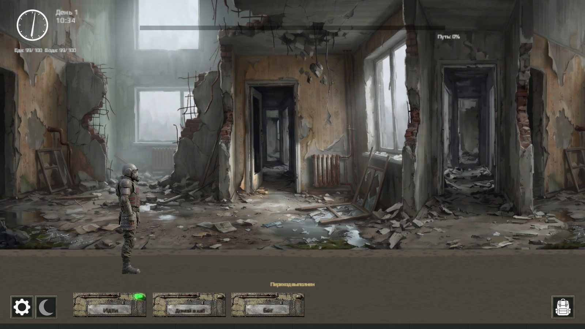
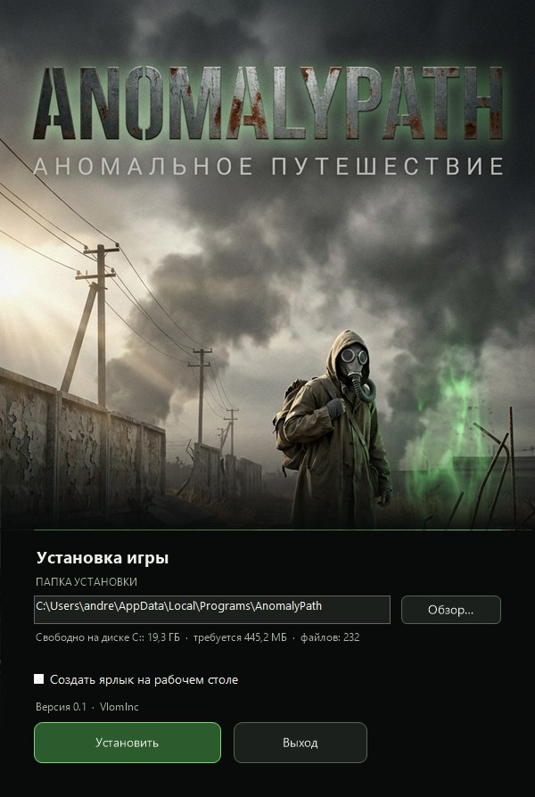

# AnomalyPath — Аномальное путешествие

**▶ [Скачать AnomalyPath-Setup.exe](https://github.com/akarpov2k/AnomalyPathGame/releases/download/v0.1/AnomalyPath-Setup.exe)**
· `0.1 Alpha Demo` · Windows 10/11 x64 · 241 МБ

[Все файлы релиза](https://github.com/akarpov2k/AnomalyPathGame/releases/latest) ·
[исходники](#техническая-часть) · [документация](#документация)

Тот же установщик лежит в релизе: в репозиторий его не положить — GitHub не принимает файлы больше 100 МБ.



## Об игре

2D-игра с рисованными локациями и кнопочным управлением. Постапокалипсис с аномальными зонами:
аномалии, артефакты, дефицит, грязный реализм. Жанровый ориентир — S.T.A.L.K.E.R., но формат
другой: экран, картинка-локация, пошаговый бой.

Игровая петля:

```
хаб → подготовка (экипировка, квесты) → выбор локации → переход
   → вылазка: события и/или бой → лут → возврат в хаб
   → продажа и сдача квестов → репутация и прокачка → следующий тир
```



Что уже играется в 0.1:

- **Умный маршрут.** Маршрут — сеть звеньев от хаба: подтипы пути, роль содержания, ветки,
  возврат в хаб только через конец пути; генерация детерминирована seed-ом.
- **Хаб.** Доска объявлений с таймерами, два торговца с ассортиментом и запасом, ремонт, отдых,
  карта мира, Депо как хаб второго тира.
- **Вылазка.** Поход по дороге с прокруткой, объекты на пути: лут, тайники, аномалии, NPC,
  противники. Взаимодействие и переход к ветке — кнопками и клавиатурой.
- **Бой.** Пошаговый: ходы, зоны попадания, патроны с пробитием, скиллы оружия, медицина, травмы,
  побег, смерть с потерей инвентаря.
- **Мини-игры.** Взлом тайника и поиск артефакта в аномальном поле.
- **Персонаж.** Инвентарь с сеткой и быстрыми слотами, снаряжение, артефакты, износ, таланты,
  левелинг, голод и жажда, ночной штраф меткости.
- **Сюжет.** Первая глава с цепочкой АТП и диалогами; квесты повторяемые и сюжетные.
- **Сохранения.** Слоты, смерть с респавном, постоянная смерть — по настройкам новой игры.



Тексты — на русском, живут в данных (`Assets/Data`), а не в коде.

## Скачать и установить

1. Скачайте **`AnomalyPath-Setup.exe`** (~241 МБ) — он один, без интернет-докачки.
2. Запустите: окно с постером, поле папки (по умолчанию `%LocalAppData%\Programs\AnomalyPath`),
   галочка «Создать ярлык на рабочем столе», кнопка «Установить».
3. После установки появится `AnomalyPath.exe` и `Uninstall.exe`; игра займёт ~445 МБ.
   Ярлык добавляется в меню «Пуск», запись — в «Установка и удаление программ»
   (`HKCU\…\Uninstall\AnomalyPath`), так что удалять можно оттуда.



- требования: Windows 10/11 x64; ставить в `Program Files` без прав администратора нельзя —
  установщик скажет об этом и предложит другую папку;
- сохранения: `%USERPROFILE%\AppData\LocalLow\VlomInc\AnomalyPath\Saves`;
- `sha256` установщика: `4969E3EC2376AAA8F21C9FA7D17180594109CFB0A23B954C9737A728A92C2D24`.

Это **0.1 Alpha Demo**: играбельная первая глава, но не финальный релиз. Дальше — больше тиров,
локаций и контента, ход работ в [ROADMAP](docs/ROADMAP.md).

## Документация

- Геймплей и правила: [docs/GAME_MANIFEST.md](docs/GAME_MANIFEST.md) — источник истины.
- Схемы данных: [docs/DATA_SCHEMAS.md](docs/DATA_SCHEMAS.md).
- План работ: [docs/ROADMAP.md](docs/ROADMAP.md).
- Лицензия и состав прав: [LICENSE](LICENSE), [NOTICE.md](NOTICE.md).
- Порядок публикации и защиты прав: [docs/PUBLISHING.md](docs/PUBLISHING.md).

## Техническая часть

Исходники — в этом же репозитории. Движок **Unity 6000.6.6f1**, шаблон Universal 2D
(URP 17.6, Renderer2D), сборка для Windows — IL2CPP (Release, Managed Stripping Medium,
.NET Standard 2.1).

| Путь | Что там |
| --- | --- |
| `src/AnomalyPath.Core/` | локальный UPM-пакет: правила, данные, репозитории, сервисы, DI — без UnityEngine |
| `src/AnomalyPath.Tests/` | пакет с общим `TestSuite` и EditMode-обёрткой |
| `tests/AnomalyPath.Core.Tests/` | консольный раннер того же набора тестов |
| `Assets/Scripts/Runtime/` | Unity-слой: `GameBootstrap`, экраны, UI |
| `Assets/Editor/` | инструменты редактора: сборка билда, сборщики префабов, скриншоты |
| `Assets/Data/` | контент: JSON-сущности, коллекции, локализация |
| `tools/installer/` | установщик `setup.exe` |
| `docs/` | документация |

Пакеты Unity подключены ссылками `file:../src/...` в `Packages/manifest.json`, поэтому редактор
компилирует те же исходники, что и `dotnet`, без копий DLL. На загрузочной сцене `GameBootstrap`
вызывает `Preflight.Run` и при ошибках не даёт игре стартовать.

Сборка и тесты вне Unity:

```powershell
dotnet build AnomalyPath.sln -m:1 -nodeReuse:false -p:UseSharedCompilation=false
dotnet run --project tests\AnomalyPath.Core.Tests -p:UseSharedCompilation=false -- Assets\Data
```

Код возврата `0` — все тесты прошли, `1` — есть падения.

Тесты в Unity (EditMode/PlayMode):

```powershell
& "C:\Program Files\Unity\Hub\Editor\6000.6.6f1\Editor\Unity.exe" -batchmode -projectPath . `
  -runTests -testPlatform EditMode -testResults Logs\TestResults.EditMode.xml
```

Билд Windows и установщик:

```powershell
& "C:\Program Files\Unity\Hub\Editor\6000.6.6f1\Editor\Unity.exe" -batchmode -quit -projectPath . `
  -executeMethod AnomalyPath.Editor.BuildScript.BuildWindows -logFile Logs\Build.log

powershell -NoProfile -ExecutionPolicy Bypass -File tools\installer\build-setup.ps1
```

Меню редактора: **Tools → AnomalyPath → Собрать Windows**. Результат — `Build/Windows/AnomalyPath.exe`,
данные игры (`Assets/Data`) копируются в `StreamingAssets`. Установщик описан в
[tools/installer/README.md](tools/installer/README.md); постер и иконка берутся из `generated/`,
которого в публичном дереве нет, — при сборке передаются параметрами `-Poster` и `-Icon`.

## Лицензия

Исходники, данные и документация — [PolyForm Noncommercial 1.0.0](LICENSE)
(`SPDX-License-Identifier: PolyForm-Noncommercial-1.0.0`), копирайт `© 2026 akarpov2k`.

Коротко:

- **можно** читать, изучать, запускать и менять для себя, делиться игрой и форками
  **без коммерческой цели** — при условии, что вместе с ними идут `LICENSE` и строка
  `Required Notice: Copyright © 2026 akarpov2k`;
- **нельзя** продавать игру, её части и производные, брать плату за доступ, включать код
  и ассеты в коммерческие продукты и сервисы, использовать в рекламе и обучении моделей
  за плату.

Билд бесплатный. Донаты (Boosty) — добровольная поддержка разработки, а не оплата игры:
они не дают прав сверх лицензии. Сторонние компоненты и их лицензии — в [NOTICE.md](NOTICE.md).
